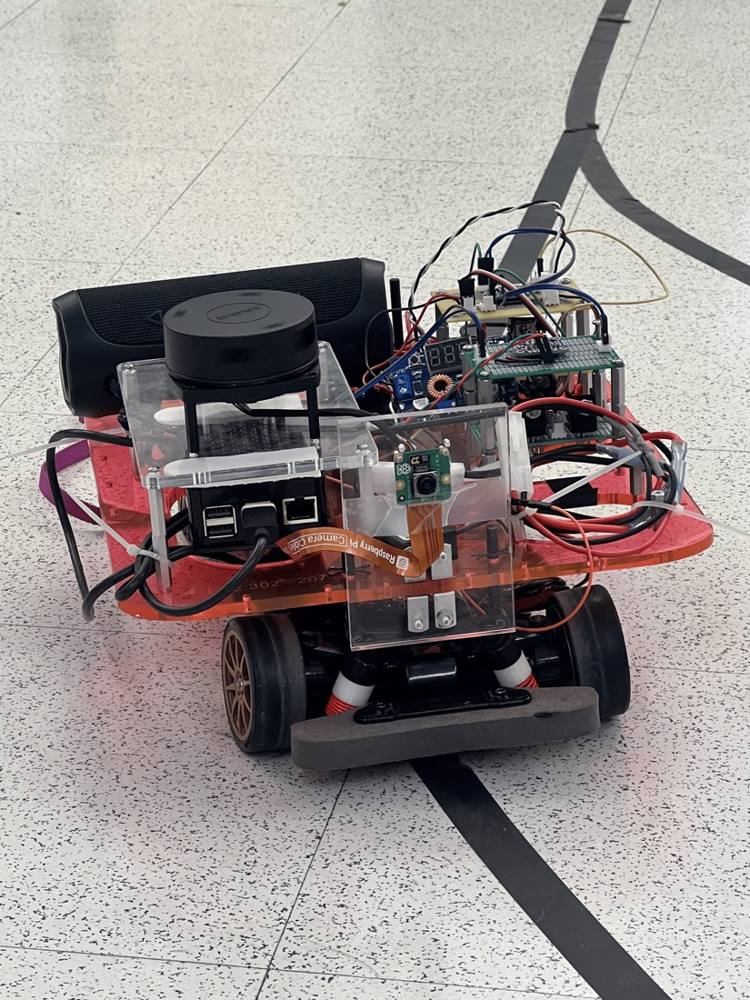
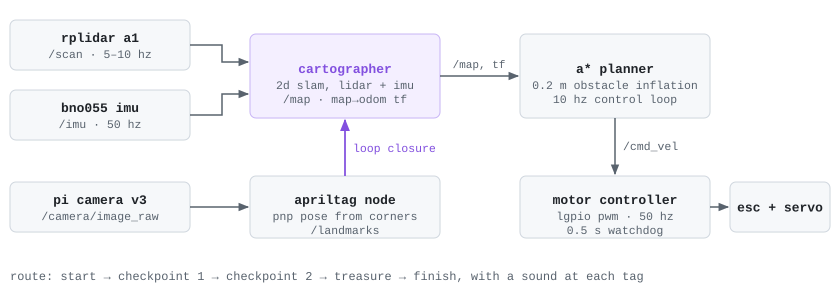
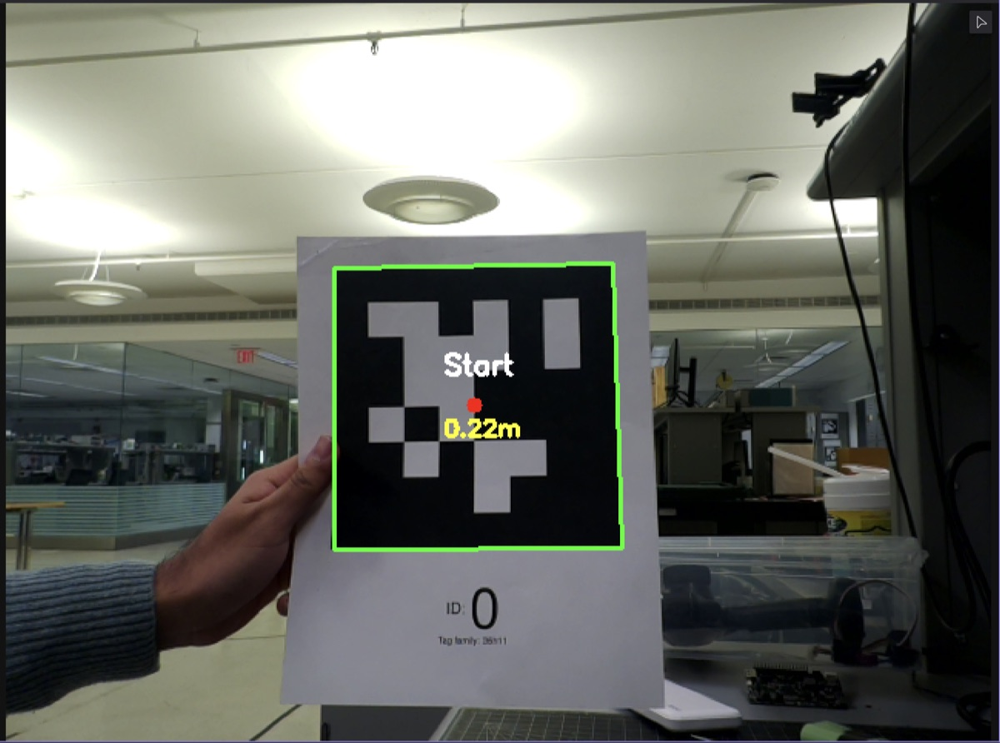
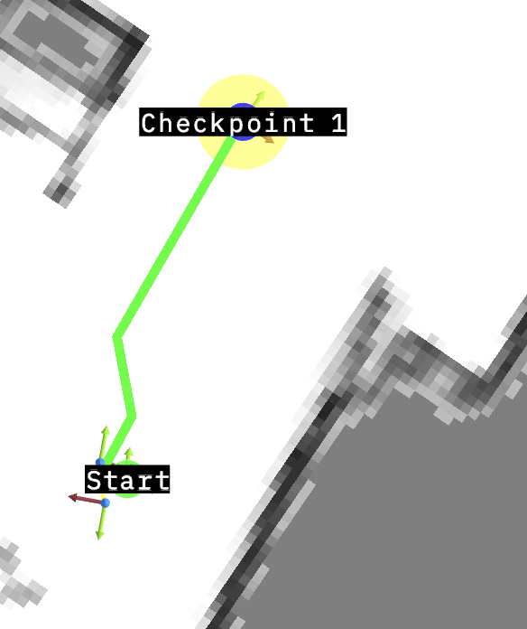

# slam-rc-car

An RC car that maps a room with lidar + IMU, finds AprilTags, and then drives a treasure-hunt route on its own (start → checkpoint 1 → checkpoint 2 → treasure → finish), playing a sound at each tag. It runs ROS 2 and Cartographer on a Raspberry Pi 5.

Final project for ECE 302 at Princeton, built with Aaryan Jagtap.

<p align="center"></p>

## How it fits together

<picture>
  <source media="(prefers-color-scheme: dark)" srcset="docs/nodes-dark.svg">
  
</picture>

- **Mapping:** Cartographer fuses `/scan` from the RPLIDAR A1 with `/imu` from a BNO055. The saved map covers about 11 × 15 m at 5 cm per cell ([`maps/`](maps)).
- **Landmarks:** the Pi Camera spots 36h11 AprilTags and estimates each pose with PnP from the four corners, averaged over several sightings. Tags go to Cartographer as `/landmarks` for loop closure and are stored as waypoints in the `map` frame.
- **Driving:** a custom A* planner runs on the occupancy grid with 0.2 m of obstacle inflation, smooths the path and publishes `/cmd_vel` from a 10 Hz control loop. The motor node turns that into 50 Hz PWM for the ESC and steering servo through `lgpio`, and stops the car if commands go quiet for 0.5 s.

| AprilTag detection | A* to the first checkpoint |
| --- | --- |
|  |  |

## Design decisions

- **No lidar-only odometry.** rf2o (laser scan matching) drifted in featureless hallways and at the A1's slow scan rate. Cartographer with the IMU as the tracking frame fixed it: the IMU covers the gaps between scans and the lidar corrects the drift.
- **Tags for loop closure.** Scan matching gets confused by repetitive rooms. A tag with a unique ID is an unambiguous "I've been here," so revisits trigger pose-graph optimization reliably.
- **Ubuntu instead of Raspberry Pi OS**, to get the full ROS 2 package set (Cartographer, tf2, Foxglove Bridge).
- **The ESC is inverted:** 100% duty is stop and 85% is full speed. The servo centers at 7.5% duty with ±2.5% of travel.

## Hardware

| Part | Model |
| --- | --- |
| Compute | Raspberry Pi 5, 8 GB |
| Lidar | Slamtec RPLIDAR A1 (360°, ~6 m range) |
| IMU | BNO055, 9-DOF |
| Camera | Pi Camera v3 |
| Drive | Brushless ESC + steering servo |

## Running it

On a Pi 5 with Ubuntu 24.04 and ROS 2 Humble:

```bash
sudo apt install ros-humble-desktop ros-humble-cartographer-ros ros-humble-foxglove-bridge
pip3 install lgpio apriltag opencv-python numpy

mkdir -p ~/ros2_ws/src && cd ~/ros2_ws/src
git clone --recurse-submodules https://github.com/aarushgoradia/slam-rc-car.git
cd ~/ros2_ws && colcon build && source install/setup.bash
```

```bash
# 1. Map: start Cartographer, then tag logging + the map saver, then drive it around by hand
ros2 launch rc_car_slam cartographer.launch.py
ros2 launch rc_car_slam mapping_mode.launch.py

# 2. Run the route: localize on the saved map and drive the waypoints
ros2 launch rc_car_slam autonomous_mode.launch.py
```

The launch files and nodes point at `/home/bench207/ros2_ws/...` for the map, the tag file and the sounds. Change those paths to match your machine.

## Repository layout

| Path | Contents |
| --- | --- |
| `src/rc_car_sensors/` | IMU, camera + AprilTag, motor controller, A* planner and autonomous navigation nodes |
| `src/rc_car_slam/` | Cartographer configs and the launch files |
| `src/rc_car_description/` | URDF + static transforms (`map → odom → base_link → laser / imu_link / camera_link`) |
| `src/sllidar_ros2/` | Slamtec's lidar driver (submodule) |
| `maps/` | The saved map (`.pgm` + `.yaml` + Cartographer `.pbstream`) |
| `sounds/` | The five checkpoint sounds |

MIT License.
